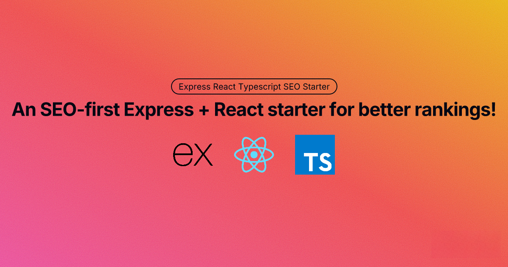

# Express React Typescript SEO Starter

[](https://www.typescriptlang.org/)
[](https://reactjs.org/)
[](https://expressjs.com/)
[](https://tailwindcss.com/)
[](https://opensource.org/licenses/MIT)
[](https://github.com/ysskrishna/express-react-helmet-seo-demo/releases)
[](https://ysskrishna.space)

A full-stack TypeScript application demonstrating advanced SEO optimization using React-Helmet-Async at the page level with an Express.js backend and React Frontend. This project showcases modern development practices including optimized production builds with esbuild, TailwindCSS for styling, and TypeScript integration throughout the stack.

<a href="https://www.producthunt.com/posts/express-react-typescript-seo-starter?embed=true&utm_source=badge-featured&utm_medium=badge&utm_souce=badge-express&#0045;react&#0045;typescript&#0045;seo&#0045;starter" target="_blank"></a>


## Product Video 👇

[](https://youtu.be/TcjIwunK8m8)

[Watch the full video on YouTube](https://youtu.be/TcjIwunK8m8)


## Features

- 🚀 Full-stack TypeScript setup with hot-reloading
- ⚛️ React with Vite for lightning-fast development
- 🎯 Page-level SEO management using React Helmet Async
- 🔧 Express.js backend with TypeScript and esbuild
- 📦 LowDB for lightweight JSON-based data persistence
- 🎨 TailwindCSS for modern, utility-first styling
- 🔄 Concurrent development servers with hot-reload
- 📝 ESLint for code quality
- 🌍 Environment variable support with dotenv
- 🏗️ Production-ready build setup with optimized bundling
- 💪 Strong typing for API endpoints and responses
- 🔒 CORS configuration for secure cross-origin requests
- 🏷️ Dynamic meta tags and title updates
- 📱 Mobile responsive layout
- 🐳 Docker support for easy deployment and testing

## Quick Start with Docker

The fastest way to run the application is using Docker Compose:

```bash
docker compose up --build
```

This will build and start the application in production mode at http://localhost:5000.

## Documentation

- **[CHANGELOG.md](CHANGELOG.md)**: Contains a chronologically ordered list of notable changes for each version of the project.
- **[DEVELOPMENT.md](DEVELOPMENT.md)**: Comprehensive guide for developers, including installation from source, development practices, dependency management with Poetry, and pre-commit hook setup.
- **[SEO.md](SEO.md)**: Detailed SEO implementation guidelines and best practices.


## Project Structure

```
react-helmet-seo-demo/
├── client/                  # Frontend React application
│   ├── src/                 # Source folder
│   │   ├── api/             # API integration and services
│   │   ├── components/      # Reusable React components
│   │   ├── pages/           # Page components with SEO
│   │   ├── types/           # TypeScript type definitions
│   │   ├── App.tsx          # Root App component
│   │   ├── App.css          # App-specific styles
│   │   ├── main.tsx         # Application entry point
│   │   ├── index.css        # Global styles
│   │   └── vite-env.d.ts    # Vite environment types
│   ├── public/              # Static assets
│   │   └── sitemap.xml      # Generated sitemap for SEO
│   ├── scripts/             # Build and utility scripts
│   │   └── generate-sitemap.js  # Script to generate sitemap
│   ├── dist/                # Frontend Build output
│   ├── index.html           # Entry HTML file
│   ├── robots.txt           # SEO robots configuration
│   ├── vite.config.ts       # Vite configuration
│   ├── tailwind.config.js   # Tailwind CSS configuration
│   ├── postcss.config.js    # PostCSS configuration
│   ├── eslint.config.js     # ESLint configuration
│   ├── tsconfig.json        # TypeScript configuration
│   ├── package.json         # Frontend dependencies
│   └── .gitignore           # Git ignore rules
├── server/                  # Backend Express application
│   ├── core/                # Core server functionality
│   ├── routers/             # API routes
│   ├── services/            # Business logic services
│   ├── types.ts             # TypeScript type definitions
│   └── index.ts             # Server entry point
├── dist/                    # Backend Production build output
├── .env                     # Backend Environment variables
├── .gitignore               # Git ignore rules
├── CHANGELOG.md             # Project changelog
├── DEVELOPMENT.md           # Development guidelines
├── LICENSE.md               # Project license
├── README.md                # Project documentation
├── SEO.md                   # SEO implementation guide
├── package.json             # Project dependencies and scripts
├── tsconfig.json            # TypeScript configuration
├── Dockerfile              # Docker configuration for the application
├── docker-compose.yml      # Docker Compose configuration
└── .dockerignore          # Docker ignore rules
```

## Technology Stack
- React + Vite + TypeScript
- React-Helmet-Async
- Tailwindcss
- Axios
- Express.js + TypeScript (Tsx for development and Esbuild for production)
- LowDB (JSON Database)
- Concurrently
- Docker

## Contributing

Contributions are welcome! Please feel free to submit a Pull Request.

## Built and maintained by

Express React Typescript SEO Starter is built and maintained by:

| | Name | GitHub | Role |
|---|------|--------|------|
|  | **Y. Siva Sai Krishna** | [@ysskrishna](https://github.com/ysskrishna) | Creator |

## Changelog

See [CHANGELOG](CHANGELOG.md) for release history.

## Support

If you find this project helpful:

- ⭐ Star the repository
- 🐛 [Report issues](https://github.com/ysskrishna/express-react-helmet-seo-demo/issues)
- 🔀 Submit pull requests
- 💝 [Sponsor on GitHub](https://github.com/sponsors/ysskrishna)

## License

MIT © [Y. Siva Sai Krishna](https://github.com/ysskrishna) — see [LICENSE.md](LICENSE.md) for details.

---

<p align="left">
  <a href="https://github.com/ysskrishna">Author's GitHub</a> •
  <a href="https://linkedin.com/in/ysskrishna">Author's LinkedIn</a> •
  <a href="https://ysskrishna.space">Author's site</a> •
  <a href="https://github.com/ysskrishna/express-react-helmet-seo-demo/issues">Report Issues</a>
</p>
